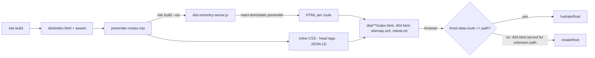

# Architecture

## Goals → decisions

| Goal                                         | Decision                                                                                                                                             |
| -------------------------------------------- | ---------------------------------------------------------------------------------------------------------------------------------------------------- |
| Static, free hosting (GitHub Pages / Vercel) | No backend. Vite build + **build-time pre-rendering** of every route                                                                                 |
| SEO + shareable case studies                 | Real paths (`/work/<slug>/`, `/en/…`) with per-route `<title>`, description, canonical, `hreflang`, Open Graph, JSON-LD; `sitemap.xml`, `robots.txt` |
| Fast first paint                             | Hero is server-rendered DOM text; CSS inlined; GSAP/Lenis/visualisations/Lab/case study are separate lazy chunks                                     |
| Works without WebGL / JS                     | Canvas-2D particles start on idle; all text is in the HTML; reveal styles only apply under `html.js`                                                 |
| Bilingual, complete                          | Typed dictionaries: `en` is typed as `Dict = typeof tr`, so a missing key is a compile error; content uses `{ tr, en }`                              |
| Maintainable content                         | All copy/data in `src/content/*`; components never hard-code facts                                                                                   |

## Stack and why

| Package                                  | Version           | Reason                                                                                |
| ---------------------------------------- | ----------------- | ------------------------------------------------------------------------------------- |
| react / react-dom                        | 19.3              | `react-dom/static` `prerender` (waits for lazy chunks) + hydration                    |
| vite / @vitejs/plugin-react              | 8.3 / 6.3         | Supports Node 20.19+ (the machine runs Node 20.20.2)                                  |
| typescript                               | ~6.0              | typescript-eslint supports `< 6.1`                                                    |
| tailwindcss + @tailwindcss/vite          | 4.3               | Token-mapped utilities; most styling is co-located component CSS                      |
| gsap (+ ScrollTrigger)                   | 3.15              | Scroll choreography; loaded after first interaction / idle                            |
| lenis                                    | 1.3               | Smooth wheel scrolling on fine pointers only                                          |
| motion                                   | 14.14             | React state transitions in the case-study chunk only (`LazyMotion` + `m`)             |
| lucide-react                             | 1.73              | Icons (brand marks are tiny inline SVGs — Lucide 1.x dropped them)                    |
| @fontsource-variable/*                   | 5.3               | Self-hosted OFL fonts                                                                 |
| vitest / jsdom / Testing Library         | 4.1 / 27.4 / 16.3 | Unit + integration (Node 20 compatible versions)                                      |
| @playwright/test / @axe-core/playwright  | 1.65 / 4.11       | E2E, responsive and accessibility tests                                               |
| lighthouse (via `npx`, not a dependency) | 12.8.2            | 13.x requires Node 22; kept out of `package.json` to avoid 36 dev-only audit warnings |

Deliberately **not** used: Three.js / React Three Fiber / OGL (the only "3D" is a CAD wireframe drawn with a
40-line projection into one SVG path — ~150 KB saved), i18next (Node 22-only and unnecessary), React Router
(three route shapes; a 150-line typed router is enough and is fully unit-tested), sound effects.

## Directory map

```
src/
  app/            App shell, pages (Home, NotFound), providers (router, locale, theme, toast), navigation helpers
  components/
    layout/       Navbar, MobileMenu, Footer, Controls (TR/EN, theme)
    motion/       Reveal/SplitWords, Counter, Magnetic, LazyMount, usePointerGlow
    visualizations/ ParticleField (+ pure physics), FederatedSim (+ fl-model), DetectionPlayground (+ detection-model),
                  AerialScene, RobotaxiScene, CadWireframe, ArchitectureGraph/PermissionMatrix, ProjectVisual, LazyVisual
    ui/           SectionHeader, BrandIcons
    feedback/     ErrorBoundary
  sections/       Hero, About, Projects (Work + archive), Research, Achievements, TechStack, Journey, InteractiveLab, Contact
  features/case-studies/  CaseStudyPage (lazy route chunk), Gallery
  content/        profile, projects, awards, timeline, skills, architectures, relations
  locales/        tr.ts (shape source), en.ts
  lib/            router, i18n, seo, scroll, gsap, prefs, pointer, storage, motion-tokens
  styles/         tokens, fonts, globals, layout
  entry-server.tsx  route list + prerender renderer (used only at build time)
scripts/          prerender-routes.mjs, build-assets.mjs (photo + OG image), extract-photo.py, lighthouse.mjs
tests/            unit, integration (Vitest) · e2e, accessibility (Playwright)
```

## Rendering pipeline



Case-study routes: React 19's `prerender` outlines large Suspense boundaries into a hidden segment revealed by
an inline script, which would make the page invisible without JS. The server therefore renders the case-study
component directly (no Suspense), and `main.tsx` imports that chunk before hydrating a case URL so both trees
match. Client-side navigation from the home page still uses `React.lazy` + `Suspense`. The prerender script fails
the build if a hidden segment ever appears again.

Hydration safety rules: no `window`/`Date`/random in render; browser-only preferences (`theme`, reduced motion,
fine pointer) use `useSyncExternalStore` with a server snapshot; the theme icon swap is pure CSS; heavy visuals
mount via `LazyMount` (placeholder on server and first client render).

## Routing

`src/lib/router.ts` (pure, tested): `parsePath(pathname, base)` → `{ locale, route }`, `buildPath(locale, route, base)`.
`RouterProvider` keeps the location in React state, pushes history entries, stores `scrollY` in `history.state`
so back/forward restores the position, and scrolls to `#hash` targets after render. Unknown slugs and archive
projects without a case study resolve to the 404 view (`resolveRoute`). Section links on the home page update the
hash with `replaceState` (no history spam) and move focus to the section.

## Performance architecture

- Main chunk ≈ 119 KB gzip (React DOM ≈ 60 KB of it + both languages' content). Lazy chunks: case study (Motion),
  visualisations, lab panels, GSAP, ScrollTrigger, Lenis.
- Below-the-fold visuals render only near the viewport (`LazyMount`, 400–600 px margin), with reserved aspect ratio (CLS 0).
- One shared pointer listener; one shared reveal observer; every rAF loop pauses off-screen (`IntersectionObserver`)
  and in hidden tabs; particle count scales with area and a device tier (cores, memory, Save-Data, reduced data, coarse pointer).
- The pinned project stage uses CSS `position: sticky` + one ScrollTrigger for progress (no GSAP pin-spacers), so
  native and smooth scrolling behave identically; it is disabled on touch, narrow and reduced-motion contexts.

## Testing map

| Layer         | Where                          | What                                                                                                                                                                                                                         |
| ------------- | ------------------------------ | ---------------------------------------------------------------------------------------------------------------------------------------------------------------------------------------------------------------------------- |
| Unit          | `tests/unit`                   | content integrity (slugs, relations, TR/EN completeness, metric context), router, i18n parity, theme persistence + boot script parity, device tier, FL state machine, detection thresholding, particle physics, SEO metadata |
| Integration   | `tests/integration`            | App rendered in jsdom: language switch, theme, mobile menu focus/Escape, tech map, archive filter, clipboard success/failure, lab controls, tab keyboard nav, deep links, next/back, 404, gallery dialog                     |
| E2E           | `tests/e2e`                    | Full visitor journey on the production build (desktop, mobile, reduced motion), deep-link refresh, link checker, CV download; **fails on any console error, page error or failed request**                                   |
| Responsive    | `tests/e2e/responsive.spec.ts` | 320–1920 px: hero never clipped, no horizontal overflow, no clipped headings, screenshots                                                                                                                                    |
| Accessibility | `tests/accessibility`          | axe (WCAG 2.0/2.1/2.2 A+AA) on TR/EN home, case studies, 404, dark theme; skip link; reduced-motion readability                                                                                                              |
